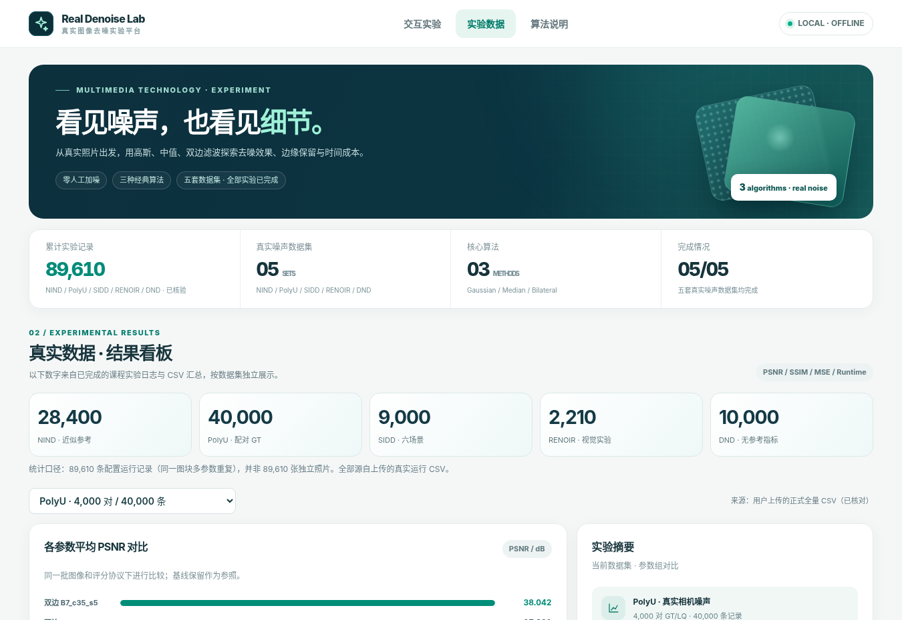

# Real Image Denoising Lab · 真实自然图像去噪实验平台

**A reproducible comparison of Gaussian, median and bilateral filters on real noisy photographs.**  
**多媒体技术课程设计 · 五套真实噪声数据集 · 无人工添加噪声 · 离线交互展示**



## 🌐 在线演示 / Demo

- **[打开 Real Denoise Lab](./index.html)** — 在仓库中下载后可直接双击打开，完全离线运行。
- 部署 GitHub Pages 后，在线地址为：`https://<你的用户名>.github.io/Real-Image-Denoising-Lab/`。
- 网页集成真实结果、参数可视化、原图与滤波效果比较、精选案例；浏览器单张实时实验是独立 JavaScript 演示，不会伪装成 Python/OpenCV 原始实测。

## 📌 项目介绍

在 **NIND / PolyU / SIDD / RENOIR / DND** 五套真实噪声数据集上，比较 **Gaussian / Median / Bilateral** 三种传统滤波器，每种三个参数组合；同一输入图像以原始基线与 9 组滤波配置记录 **10 次处理结果**。

- 不添加高斯、椒盐等模拟噪声；不对图像进行“先加噪再去噪”的处理。
- 采用有参考与无参考分开的评价协议，避免不具备真值时虚构 PSNR/SSIM。
- 支持批量真实数据评测、逐图明细 CSV、参数汇总 CSV、代表图可视化、Windows BAT 启动和断点续跑（取决于实验脚本）。

## 📊 实验结果概览

| 数据集 | 实际处理记录 | 评价方式 | 该数据集的重点结果 |
|---|---:|---|---|
| NIND | 28,400 | 低 ISO 图像作为近似参考；有效配准图块计算 PSNR/SSIM | 双边 d9_c70_s7 平均 PSNR **31.548 dB**（仅有效图块） |
| PolyU | 40,000 | LQ/GT 成对 sRGB；PSNR/SSIM/MSE | 双边 B7_c35_s5 平均 PSNR **38.042 dB** |
| SIDD | 9,000 | `0001` + 五个新增场景；NOISY/GT | 六场景合计双边 B9_c50_s7 平均 PSNR **38.683 dB** |
| RENOIR | 2,210 | 视觉比较 + 耗时；参考图配准未严格验证 | S90 62 对，Mi3 79 对，T3i 80 对 |
| DND | 10,000 | 官方 1,000 图块；**无公开 GT** | 高频变化、边缘梯度变化与耗时 |
| **总计** | **89,610** | | |

> ⚠️ **统计说明：** 89,610 是“图块/图像 × 参数”的 **处理记录数**，不是独立图片的数量。不同数据集的成像条件、参考图质量及评价协议不同，**不能把五套数据集的平均 PSNR 直接横向排序**。RENOIR、DND 的本地 PSNR/SSIM/MSE 均不报告。

## 📂 仓库结构

```text
Real-Image-Denoising-Lab/
├── index.html                     # GitHub Pages 网页入口（单文件、离线）
├── README.md
├── .gitignore
├── requirements.txt
├── scripts/
│   ├── nind/                      # NIND 数据清单、下载和全量滤波
│   ├── polyu_sidd_renoir/         # PolyU/SIDD/RENOIR 通用实验脚本
│   └── dnd/                       # DND HDF5/MAT 图块处理
├── results/
│   ├── NIND/                      # 28,400 条和 ISO/场景/算法统计
│   ├── PolyU/                     # 40,000 条 + 配对与参数统计
│   ├── SIDD/                      # 1,500 + 7,500 条
│   ├── RENOIR/                    # 620 + 1,590 条，无参考评分
│   ├── DND/                       # 10,000 条 + 1000块像素核验
│   ├── five_datasets_summary.csv
│   └── validation_summary.json
├── assets/
│   ├── comparisons/              # **实际实验输出**的精选对比图
│   ├── charts/
│   ├── ATTRIBUTION.md
│   └── preview_dashboard.png
└── report/
    └── 实验报告.docx               # 可用 Word / WPS 编辑
```

## 🚀 GitHub Pages 发布

1. 创建同名公开仓库 `Real-Image-Denoising-Lab`，使用 GitHub Desktop 克隆到本地。
2. 将本压缩包中 **`Real-Image-Denoising-Lab` 文件夹里面的全部内容** 复制到克隆后的仓库根目录；**不要额外再嵌套一层同名文件夹**。
3. 在 GitHub Desktop 提交（Commit）并推送（Push origin）。
4. 在仓库 **Settings → Pages → Build and deployment → Deploy from a branch** 中选择 `main` 和 `/(root)`，保存。GitHub Pages 会识别根目录的 `index.html`。
5. 在 README 顶部将 `<你的用户名>` 替换为你的实际 GitHub 用户名。

本项目网页已将展示所需资源内嵌至 `index.html`，无需服务器、数据库或 Python 后端。较大的 CSV 明细仅用于可复现研究，不必在线逐行加载。

## 🖥️ 本地运行 Python 实验

```powershell
py -3 -m pip install -r requirements.txt
```

原始数据不包含在仓库中。把官方数据集解压到如下**本地目录**，它们会被 `.gitignore` 忽略：

```text
datasets/
├── NIND/               # NIND 全量图片
├── PolyU/              # PolyU 数据及 train_sub/GT 与 train_sub/LQ
├── SIDD/               # 0001_...、0035_... 等 GT/NOISY 目录
├── Renoir/             # S90_Aligned、Mi3_Aligned、T3i_Aligned
└── DND/                # images_srgb/、images_raw/、info.mat、pixelmasks.mat
```

然后在 Windows 电脑中双击各 `scripts/<数据集>/` 内的 BAT（CRLF 换行，带中文路径也可使用）；输出默认写入不提交 Git 的 `outputs/`。也可以直接调用 Python，例如：

```powershell
py -3 scripts/nind/run_full_nind.py --root datasets/NIND --out outputs/NIND
py -3 scripts/polyu_sidd_renoir/run_real_denoise.py --dataset polyu --data datasets/PolyU --out outputs/PolyU --crop 512
py -3 scripts/polyu_sidd_renoir/run_real_denoise.py --dataset sidd --data datasets/SIDD --out outputs/SIDD --sidd-scenes 0035,0063,0094,0118,0146 --crop 512
py -3 scripts/polyu_sidd_renoir/run_real_denoise.py --dataset renoir --data datasets/Renoir --out outputs/RENOIR --renoir-cameras Mi3,T3i --crop 512
py -3 scripts/dnd/run_dnd.py --data datasets/DND --out outputs/DND --previews 10
```

> 如果原始数据不在仓库下，BAT 支持先设置环境变量 `DENOISE_DATA_DIR` 指向**当前实验数据集的完整路径**，或在命令行使用 `--data / --root` 明确指定。不要把几十 GB 的数据集放进仓库。原图缺失时无法仅凭 CSV 重新生成滤波结果。

## 📈 数据与统计使用说明

- `results/NIND/records.csv`：NIND 逐图逐参数结果。仅满足配准筛选的图块具备可解释的 PSNR/SSIM；请查看 `pair_status`。
- `results/PolyU/records.csv`：4,000 对 ×10 组配置。
- `results/SIDD/0001_records.csv` 和 `five_scenes_records.csv`：六场景，合计 9,000 条记录。
- `results/RENOIR/`：S90 和 Mi3/T3i 分开保存，避免按当前已保留的磁盘样本数量覆盖历史全量数据。
- `results/DND/records.csv`：官方图块的九组滤波 + 输入基线；`verified_patches.csv` 核验像素可读取；高频变化和边缘梯度变化不是带 GT 的客观质量得分。
- `results/five_datasets_summary.csv`：统一参数总表；`results/validation_summary.json`：数据完整性摘要。

## 🖼️ 数据来源、致谢与合规

这个仓库只存放实验程序、统计 CSV 和少量从实际实验输出中挑选的对比图；**不包含原始数据集的完整副本**。使用前请阅读各数据集的授权条款：

- NIND：[Wikimedia Commons — Natural Image Noise Dataset](https://commons.wikimedia.org/wiki/Natural_Image_Noise_Dataset)
- PolyU：[PolyU-Real-World-Noisy-Images-Dataset](https://github.com/csjunxu/PolyU-Real-World-Noisy-Images-Dataset)（部分材料适用非商业使用限制）
- SIDD：[Smartphone Image Denoising Dataset](https://abdokamel.github.io/sidd/)
- RENOIR：*A Dataset for Real Low-Light Image Noise Reduction*（Anaya & Barbu）
- DND：[Darmstadt Noise Dataset](https://noise.visinf.tu-darmstadt.de/benchmark/)

**重要：** 公开发布第三方数据集图像及其衍生拼图前，请核实对应授权、署名与再分发要求；`assets/comparisons/` 内的是实验输出而非作者原创摄影。参见 [`assets/ATTRIBUTION.md`](assets/ATTRIBUTION.md)。本仓库暂未为全部材料选择一个统一的开源 LICENSE，以免无意覆盖第三方数据的原始授权；代码如需正式开源许可可单独加许可证并注明第三方例外。

## 📝 报告

[五数据集实验报告（Word）](report/实验报告.docx) 包括算法原理、五数据集实验协议、PSNR/SSIM/MSE/耗时、参数敏感性、实际图片对比、局限性和复现说明。

---

**Course project / educational research only.** Experimental records are from the user's actual batch runs, not scores copied from external GitHub repositories.  
**Disclaimer:** Reference images in NIND are approximate low-ISO proxies; RENOIR images have not been strictly verified for registration; DND clean reference images are not public.
